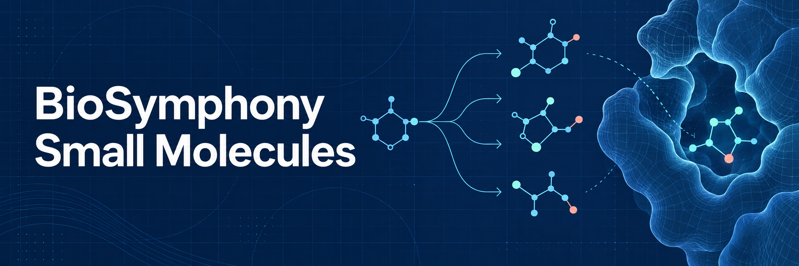

# BioSymphony Small Molecules

Use your AI agent to design small molecules, investigate binding, and plan the
next experiment. BioSymphony Small Molecules gives your agent the tool
knowledge to build and run workflows across molecular generation, docking,
property prediction, free energy, and synthesis planning.

Start with your research question and the structures, compounds, or assay data
you have. Your agent uses the guides to choose methods, set up upstream
software, connect inputs and outputs, and assess what the results support.

The [November 2026 tool updates](references/tool-update-2026-11.md) add optical
prediction, spectrum interpretation, biosynthetic-cluster models, molecular
simulation, and evaluation methods. The guide also identifies release changes
that affect checkpoint and environment compatibility.

## Start with a research question

Point your agent at [SKILL.md](SKILL.md) with your inputs and compute budget.

```text
Use https://github.com/BioSymphony/small-molecules to optimize my hit series.
Compare analogs using binding predictions, ADMET, and synthesis routes within
my compute budget. Return a diverse shortlist, the results supporting each
choice, and a controlled experiment plan to distinguish the leading candidates.
```

## Research workflows

| What you want to investigate | Tools your agent can combine | What to ask it to deliver |
| --- | --- | --- |
| Which analogs fit a binding pocket and have plausible synthesis routes? | DiffSBDD or LDDM → PoseBusters → ADMET-AI → PrexSyn → re-docking and re-scoring → AiZynthFinder → RENKIN | Candidate structures, pose and property checks, proposed routes, and a shortlist with reasons for each selection. [Design guides](references/structure-based-generation.md) |
| Which compounds should receive the next docking calculations? | MolPAL with a configured docking objective → pose checks on selected compounds | Successive screening batches, scores by compound ID, and comparison with random selection under the same docking budget. [Active-learning tools](references/property-and-qsar-prediction.md) |
| Which changes to a hit are worth testing? | REINVENT 4 Mol2Mol → Chemprop trained on assay data → ADMET-AI → synthesis planning | Analog predictions, held-out model performance, property tradeoffs, and a proposed assay panel with controls. [Analog design](references/structure-based-generation.md) and [QSAR](references/property-and-qsar-prediction.md) |
| How do close analogs compare in predicted binding free energy? | Ligand structures with pose checks → OpenFE → review alongside ADMET and route results | Relative free-energy estimates, uncertainties, convergence checks, and compounds to prioritize for measurement. [Free-energy methods](references/binding-affinity-and-fep.md) |
| Which synthesis planner works best for my targets and stock? | AiZynthFinder compared with RetroChimera + Syntheseus | Routes, stock coverage, search cost, and failed searches under a common target set, stock, and declared budgets. [Planning and search](references/retrosynthesis-planning.md) |
| Can a model recover the ligand pose and protein arrangement in a molecular-glue complex? | Experimental ternary structure → smina docking controls → Chai-1 comparison → interface analysis | A comparison of predicted poses with the experimental complex, including ligand contacts and protein placement. [Public KRAS example](references/worked-example-kras-glue.md) |
| Which dyes have useful optical properties in a chosen solvent? | Multi-Fluor or a suitable optical predictor → domain and endpoint checks | Absorption/emission predictions and other supported optical endpoints for each solute/solvent pair. [Optical models](references/property-and-qsar-prediction.md) |
| Which molecular structures could explain a measured spectrum? | MS-GPT for known-formula MS/MS; UltraNMR or NMRTrans for their supported NMR inputs | Ranked candidates, required formula/modality checks, and comparisons with reference compounds. [Analytical models](references/analytical-chemistry-models.md) |
| Which alternative conformations might a protein–ligand complex adopt? | OriDynamics or BioEmu-2 → frame and geometry checks | Conformational ensembles with model-specific interpretation of time and populations. [Molecular simulation](references/molecular-potentials-and-simulation.md) |

## Build a design campaign

For a receptor structure and a bound fragment, ask your agent to assemble the
following workflow. Set the candidate count, required properties, available
compute, and synthesis stock for your question.

| Step | Work the agent performs | Files and results passed forward |
| --- | --- | --- |
| Prepare the study | Inspect receptor chemistry, pocket boundaries, ligand states, and required cofactors. Choose reference compounds and pose controls. | Prepared receptor PDB, reference ligand SDF, pocket definition, and comparison criteria |
| Propose candidates | Use DiffSBDD for pocket generation or LDDM for fragment editing. Preserve the requested structural constraints. | Candidate SDF records with stable compound IDs |
| Evaluate candidates | Check molecular identity and geometry with PoseBusters. Export SMILES for ADMET-AI and any task-specific property model. | Pose reports and endpoint predictions joined by compound ID |
| Explore synthesis options | Use PrexSyn to propose related structures with synthesis pathways. Give changed molecules new IDs linked to their parents. | Proposed structures, synthesis pathways, and parent–candidate mappings |
| Re-evaluate changed molecules | Generate poses for the changed structures, then repeat pose, property, and any affinity checks used for selection. | Comparable results for the actual structures under consideration |
| Plan routes and select follow-up | Send selected SMILES to AiZynthFinder and its route-tree JSON to RENKIN with the declared stock. Compare route results with predicted properties. | Candidate shortlist, route files, stock checks, and proposed measurements |

Keep stereochemistry and compound identity consistent across SDF, SMILES, and
result tables. Treat pose confidence, predicted properties, affinity estimates,
and measured activity as distinct evidence when choosing the next experiment.
[Pose checks](references/docking-and-cofolding.md#validate-poses) ·
[Synthesis projection](references/synthesizable-generation.md) ·
[Route validation](references/retrosynthesis-planning.md#validate-routes) ·
[AiZynthFinder–RENKIN handoff](https://kent-tokyo.github.io/renkin/guides/aizynthfinder-audit-demo/)

## Plan experiments that answer the question

Ask your agent to specify the hypothesis, comparison, controls, and how the
possible results affect your next decision. For a generative campaign, that includes how
many molecules to sample, how to preserve diversity, and how to evaluate
survivors. For a property model, it includes the assay endpoint, training data,
and held-out evaluation. The guides cover pose controls, model validation, and
route checks. [Docking](references/docking-and-cofolding.md) ·
[QSAR](references/property-and-qsar-prediction.md) ·
[Retrosynthesis](references/retrosynthesis-planning.md)

For a hit series, choose a data split that tests generalization across relevant
chemical series and reserve a test set for final model evaluation. Propose an
assay panel with reference compounds, candidate structures, and a reason for
each measurement. [Chemprop training and data splits](https://chemprop.readthedocs.io/en/main/tutorial/cli/train.html)

When requesting a run, ask for the attempted, completed, and failed calculations
and the number of unique molecules meeting your criteria. Use those results
to decide whether to expand the search, change a method, or test the shortlist.

## Tools your agent can use

### Structure and generation

| Task | Tool and starting input | Output |
| --- | --- | --- |
| Predict a receptor structure | [ColabFold](references/protein-structure-prediction.md) with a protein sequence | Structure models and confidence scores |
| Find a binding pocket | [P2Rank](references/structure-based-generation.md#p2rank--rdkp2rank) with a receptor structure | Ranked pocket predictions |
| Design candidates in a pocket | [DiffSBDD](references/structure-based-generation.md#diffsbdd--arneschneuingdiffsbdd) with a receptor PDB and pocket residues or a reference ligand | Candidate structures in 3D |
| Optimize analogs against selected objectives | [REINVENT 4](references/structure-based-generation.md) with seed molecules or a scaffold and a scoring configuration | Generated molecules and component scores |
| Edit a fragment within a pocket | [LDDM](references/lddm.md) with a prepared pocket and ligand atom constraints | Candidate structures that preserve selected input atoms |
| Grow, decorate, or link molecular fragments | [GenMol](references/molecular-generation.md) with a fragment or scaffold | Candidate molecules |
| Find candidates similar to a query molecule | [PrexSyn](references/synthesizable-generation.md) with a query SMILES or a supported fingerprint | Candidate molecules with proposed synthesis pathways |

### Docking and binding

| Task | Tool and starting input | Output |
| --- | --- | --- |
| Prepare files for docking | [Meeko](references/docking-and-cofolding.md) with a receptor PDB and a 3D ligand SDF with explicit hydrogens | Receptor and ligand PDBQT files |
| Dock a ligand into a known pocket | [AutoDock Vina](references/docking-and-cofolding.md) with prepared receptor and ligand files and a search box | Ranked poses and empirical docking scores |
| Predict poses with learned docking | [DiffDock-L](references/docking-and-cofolding.md) with a receptor structure and ligand | Ranked poses and pose-confidence scores |
| Check docked poses | [PoseBusters](references/docking-and-cofolding.md#validate-poses) with docked poses in SDF and a receptor PDB | Per-pose geometry and clash checks |
| Predict a protein–ligand complex | [Boltz-2](references/docking-and-cofolding.md) with a protein sequence and ligand SMILES or CCD code, typically with a multiple sequence alignment | Predicted complex structure and an optional affinity estimate |
| Compare binding across related ligands | [OpenFE](references/binding-affinity-and-fep.md) with a prepared receptor PDB and ligand poses in SDF, in the same coordinate frame | Relative binding free-energy estimates |

### Properties, selectivity, and synthesis

| Task | Tool and starting input | Output |
| --- | --- | --- |
| Predict an assay endpoint | [Chemprop](references/property-and-qsar-prediction.md) with labeled molecules to train on and new molecules to score | Endpoint predictions for new molecules |
| Select the next virtual-screening batch | [MolPAL](references/property-and-qsar-prediction.md) with a SMILES pool and a configured scoring objective | Selected compounds and accumulated scores |
| Screen ADMET endpoints | [ADMET-AI](references/admet-prediction.md) with ligand SMILES | Predicted absorption, distribution, metabolism, excretion, and toxicity endpoints |
| Compare a candidate with a known off-target ligand | [ESP-Sim](references/target-and-selectivity-prediction.md) with 3D ligand conformers | Shape and electrostatic similarity scores |
| Propose precursors for one reaction | [ReactionT5v2](references/singlestep-retrosynthesis.md) with a product SMILES and the retrosynthesis checkpoint | Ranked precursor sets |
| Search for multi-step synthesis routes | [AiZynthFinder](references/retrosynthesis-planning.md) with a target SMILES and a configured model and stock | Ranked routes as route-tree JSON |
| Search with a chosen one-step model | [RetroChimera + Syntheseus](references/retrosynthesis-planning.md) with target SMILES, model settings, and stock | Ranked precursor predictions and multi-step search results |
| Check proposed synthesis routes | [RENKIN](references/retrosynthesis-planning.md) with route JSON and a starting-material stock | Route structure and stock checks, plus reaction replay where reaction data permits |

Use the [tool matrix](references/tool-matrix.md) to compare alternatives. The
reference guides link to upstream documentation and describe setup, hardware,
and method limits. For artifact terms, see the
[licensing and data guide](references/licensing-and-data.md).

### Optical Properties, Spectra, and Molecular Simulation

| Task | Tool and Starting Input | Output |
| --- | --- | --- |
| Predict solvent-dependent optical properties | [Multi-Fluor](references/property-and-qsar-prediction.md) with solute and solvent SMILES | Absorption/emission maxima, quantum yield, and log molar absorptivity |
| Propose structures from MS/MS | [MS-GPT](references/analytical-chemistry-models.md) with a spectrum, molecular formula, and matching model assets | Ranked connectivity candidates |
| Predict NMR peak lists | [PRISM](references/analytical-chemistry-models.md) with molecular SMILES and the forward H1/C13 models | Predicted proton and carbon peak lists |
| Propose a metabolite from a biosynthetic cluster | [DeepSeMS](references/multimodal-chemical-models.md) with an annotated cluster and Pfam assets | Ranked metabolite structures and ensemble consensus |
| Calculate molecular energy and forces | [AIMNet2](references/molecular-potentials-and-simulation.md) with supported elements, coordinates, and net charge | Energy and atomic forces in the model's declared units |
| Prepare molecular features in batches | [cuik-molmaker or nvMolKit](references/molecular-compute-infrastructure.md) with the library's SMILES or RDKit inputs | Features, similarities, or conformers through CPU/GPU-specific interfaces |

Use the [evaluation guide](references/model-evaluation-and-benchmarks.md) to
choose matched baselines, preserve chemical splits, and check a first result.

## Inspect a docking handoff

The public 1IEP example asks whether CPU docking can recover imatinib’s
experimental pose. Meeko stores the ligand’s SMILES and atom mapping in the
PDBQT file. Keep those records through the Vina run so Meeko can reconstruct
the ligand’s bond orders when exporting the poses to SDF.
[AutoDock Vina tutorial and input files](https://autodock-vina.readthedocs.io/en/latest/docking_basic.html) ·
[Meeko export](https://meeko.readthedocs.io/en/develop/export_usage.html) ·
[PoseBusters CLI](https://posebusters.readthedocs.io/en/latest/cli.html)


[Open the full-size diagram](assets/skill-map.svg)

Use the docking scores to rank poses and PoseBusters to check geometry,
clashes, and recovery of the crystal pose. Binding affinity requires a
separate method. [Affinity and free-energy guide](references/binding-affinity-and-fep.md)

## More references

- [Forward reaction modeling](references/forward-and-reaction-modeling.md)
  covers product prediction and checks for proposed retrosynthetic steps.
- [Agentic drug design](references/agentic-drug-design.md) compares frameworks
  that orchestrate multiple tools.
- [LDDM](references/lddm.md) covers docking, fragment editing, and generation
  with a single model family.
- [KRAS molecular-glue example](references/worked-example-kras-glue.md) shows how
  a public ternary structure changes the choice of modeling method.

<details>
<summary>Use the packaged skill in Claude Code</summary>

Clone the repository and register the skill in your
[Claude Code skills directory](https://code.claude.com/docs/en/skills).

```sh
git clone https://github.com/BioSymphony/small-molecules.git
cd small-molecules
mkdir -p ~/.claude/skills
ln -s "$PWD/skills/small-molecule-design-tools" ~/.claude/skills/small-molecule-design-tools
```

Invoke `/small-molecule-design-tools` with your task. Codex can use the
[packaged skill](skills/small-molecule-design-tools/SKILL.md) from the checkout.

</details>

## Contributing

See [CONTRIBUTING.md](CONTRIBUTING.md) for source requirements and checks.

## License

The repository uses the [MIT License](LICENSE). Upstream tools and artifacts
have their own terms.
